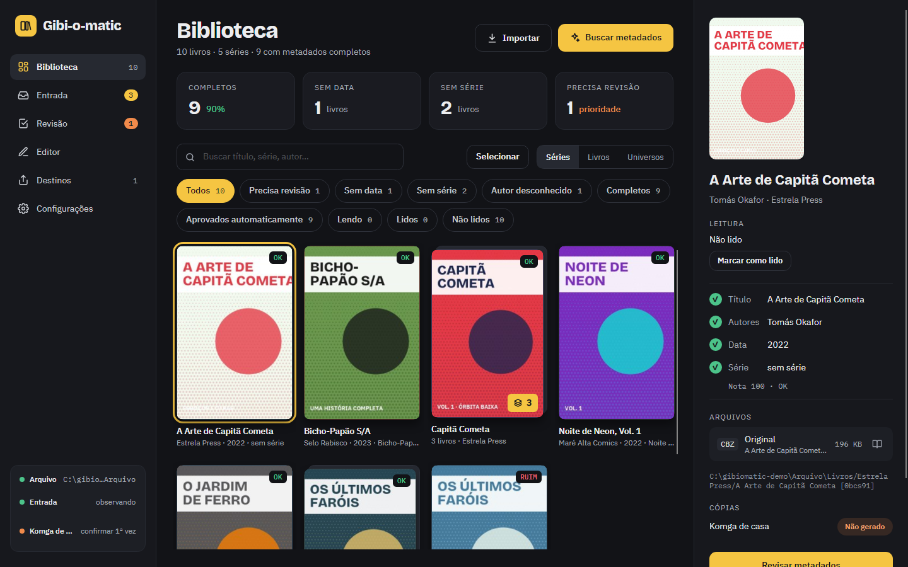
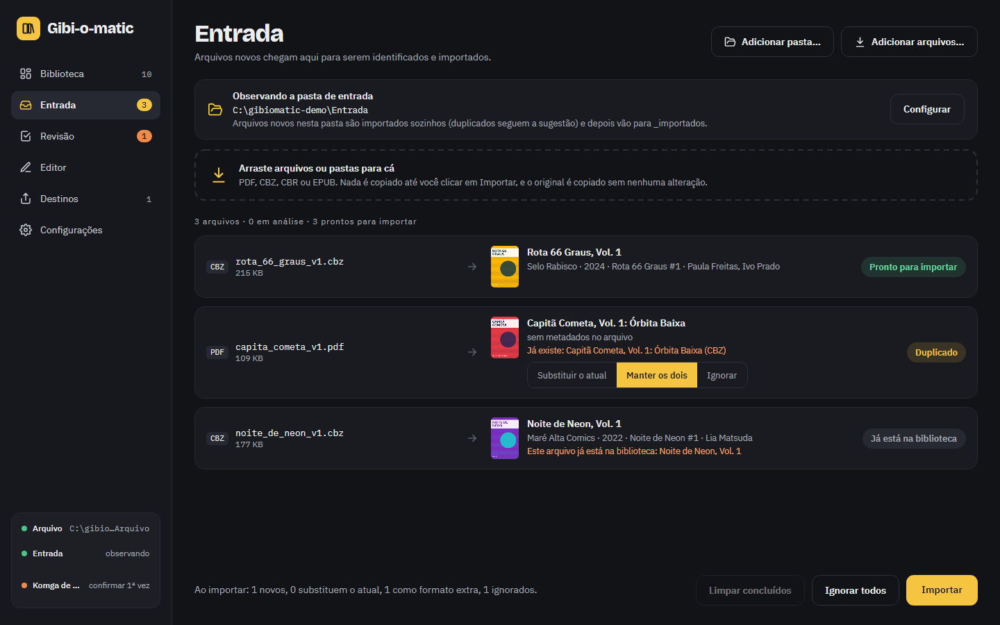
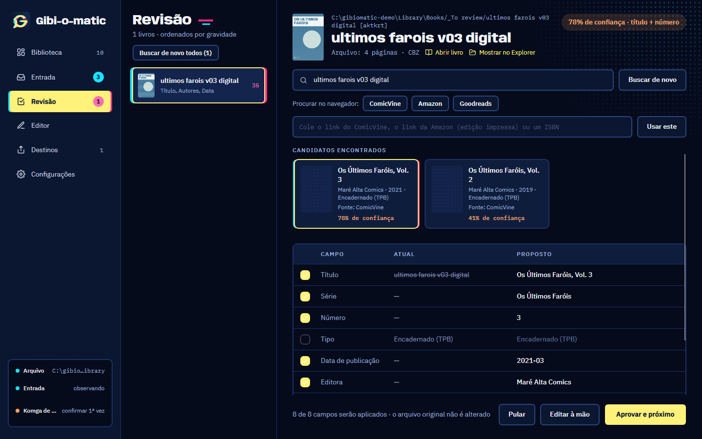
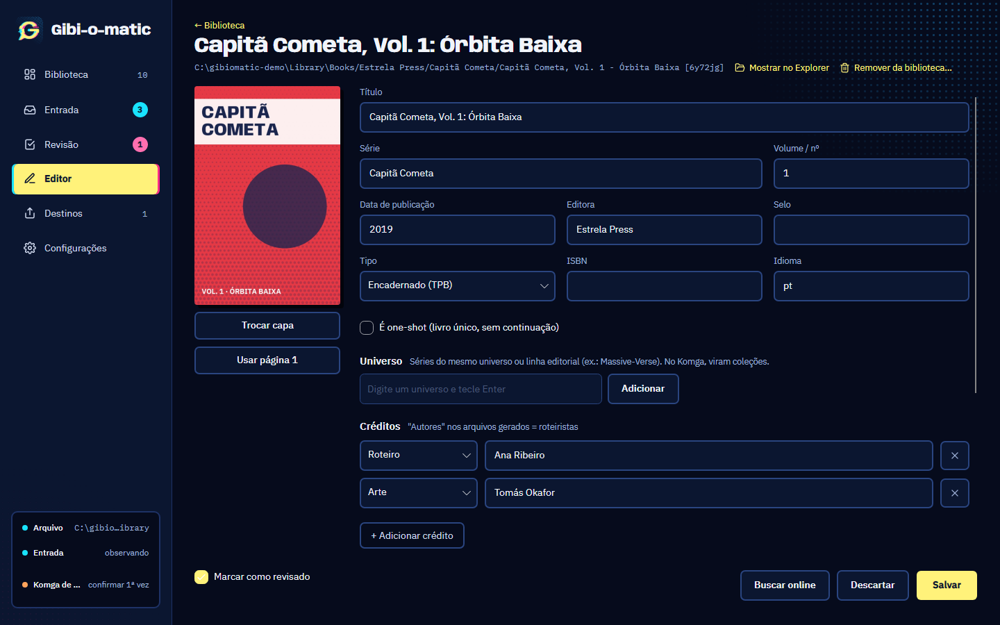
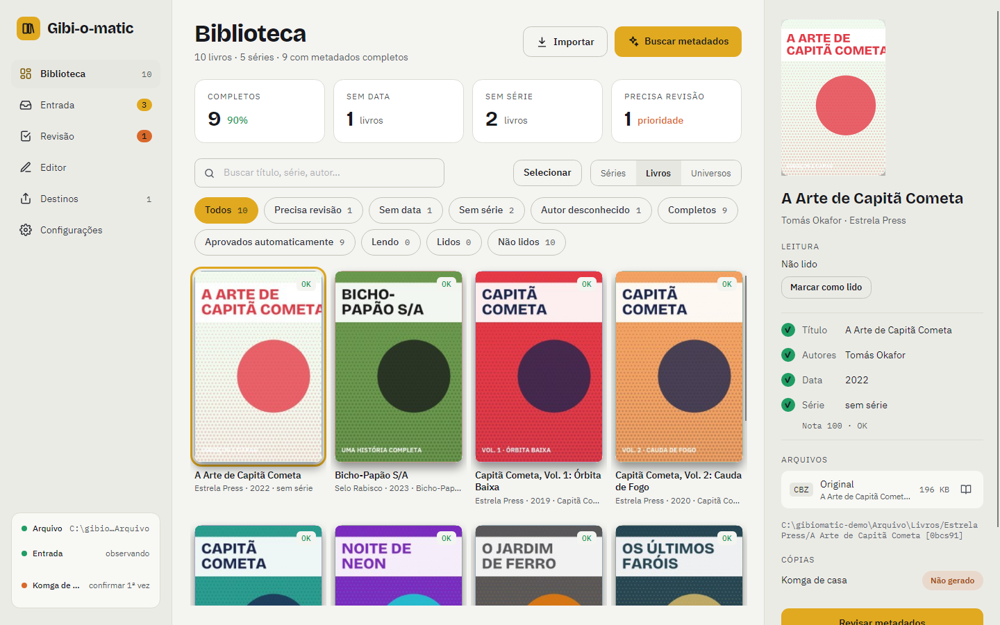

# Gibi-o-matic

Organizador de quadrinhos digitais comprados (Humble Bundle e afins), para Windows e Linux. Ele guarda os
originais intocados, acerta os metadados e gera as cópias de leitura para onde você lê: um servidor
[Komga](https://komga.org) ou um Kindle.

## O que ele faz

- **Arquivo dos originais.** Cada livro ganha uma pasta com o original como foi baixado (PDF, CBZ, CBR ou
  EPUB), a capa e um `metadata.json`. O original nunca é alterado; o mesmo livro em vários formatos vira um
  livro só, com o formato preferido como principal.
- **Entrada automática.** Aponte a pasta de downloads e cada arquivo novo entra sozinho na biblioteca. Depois
  ele vai para a Lixeira (ou para `_imported`, dentro dela, se preferir). Os livros esperam em `_To review`
  até os metadados serem aprovados. O app pode ficar na bandeja do sistema e iniciar com ele.
- **Metadados.** Busca no ComicVine e na Open Library. As identificações seguras são aprovadas sozinhas, e
  as outras esperam na **Revisão**, com a comparação campo a campo. O **Editor** cuida do resto, inclusive
  em lote. Uma nota de qualidade aponta o que falta em cada livro.
- **Destinos.** O **Komga** recebe CBZ com `ComicInfo.xml`, organizados por série. O **Kindle** recebe as
  cópias convertidas pelo Kindle Comic Converter, preparadas antes e enviadas por USB quando você conecta o
  aparelho. Editar um livro atualiza as cópias.
- **Leitor** próprio para CBZ, CBR, PDF e EPUB, com página dupla, leitura da direita para a esquerda e
  progresso de leitura.
- Interface em português e em inglês, tema escuro e tema claro.

| Entrada | Revisão |
|---|---|
|  |  |
| **Editor** | **Tema claro** |
|  |  |

As capturas usam uma biblioteca inventada (títulos, autores e capas fictícios), gerada por `tools/Screenshots`.

## Instalação

Baixe a última versão em **Releases**:

- **Windows 10 ou 11:** `Gibi-o-matic-win-Setup.exe`. Ele instala só para o seu usuário, sem pedir
  administrador, e cria atalhos na área de trabalho e no menu Iniciar. Na primeira vez, o Windows pode avisar
  "editor desconhecido" (o instalador ainda não é assinado): clique em *Mais informações* → *Executar assim mesmo*.
- **Linux:** `Gibi-o-matic.AppImage`. Dê permissão de execução (`chmod +x Gibi-o-matic.AppImage`) e abra.

O app já traz o .NET; não é preciso instalar mais nada. A versão instalada procura atualizações sozinha e
avisa quando há uma nova; nada é instalado sem você pedir.

## Primeiros passos

1. **Crie a biblioteca** numa pasta vazia (pode ser no Google Drive, por exemplo). É lá que ficam os originais
   e os metadados. O índice e o cache ficam fora dela, na sua máquina.
2. **Chave do ComicVine** (recomendada): crie uma conta em
   [comicvine.gamespot.com/api](https://comicvine.gamespot.com/api/), copie a chave e cole em
   *Configurações → Metadados*. Ela fica guardada protegida pelo Windows e nunca vai para arquivos de texto.
   No Linux, onde isso ainda não existe, use a variável de ambiente `GIBIOMATIC_COMICVINE_KEY`.
3. **Importe** arrastando arquivos para a *Entrada*, ou escolha uma pasta de Entrada em
   *Configurações → Pastas* para os downloads entrarem sozinhos.
4. **Revise** o que a identificação não aprovou sozinha.
5. **Adicione um destino** em *Destinos*:
   - **Komga:** a pasta da biblioteca do Komga. O endereço e a chave do servidor são opcionais e servem para
     pedir uma nova leitura da pasta depois das mudanças.
   - **Kindle:** o app baixa o Kindle Comic Converter quando você pede. Para gerar os arquivos, ele usa o
     KindleGen que vem com o Kindle Previewer, da Amazon (instale-o antes). No Linux, o envio por USB ainda não é suportado.

## Onde ficam as coisas

| O quê | Onde |
|---|---|
| Originais, capas e `metadata.json` | na pasta da biblioteca que você escolheu |
| Configurações | `%APPDATA%\GibiOMatic` (Linux: `~/.config/gibiomatic`) |
| Índice, miniaturas, cache e logs | `%LOCALAPPDATA%\GibiOMatic` (Linux: `~/.local/share/gibiomatic`) |
| Programa instalado | `%LOCALAPPDATA%\Gibi-o-matic` |

Desinstalar remove só o programa: a biblioteca, as configurações e o índice continuam onde estão.

**O que vai para a internet:** as buscas de metadados (ComicVine, Open Library e, se você ligar, Google
Books), o download do Kindle Comic Converter (GitHub, quando você pede) e a procura de atualizações (GitHub).
O conteúdo dos seus arquivos não sai da sua máquina.

## Desenvolvimento

Veja [`CONTRIBUTING.md`](CONTRIBUTING.md). A especificação está em [`docs/SPEC.md`](docs/SPEC.md), as fases
em [`docs/ROADMAP.md`](docs/ROADMAP.md) e as decisões em [`docs/DECISIONS.md`](docs/DECISIONS.md).

## Licença

MIT. Veja [`LICENSE`](LICENSE). As dependências e as licenças delas estão em
[`docs/THIRD-PARTY.md`](docs/THIRD-PARTY.md).
