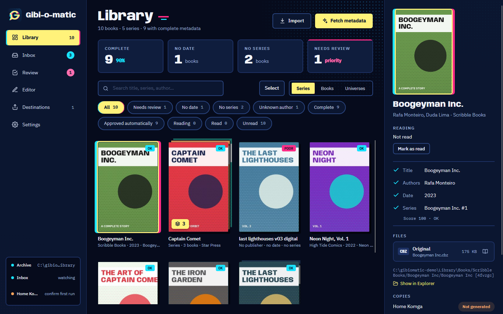
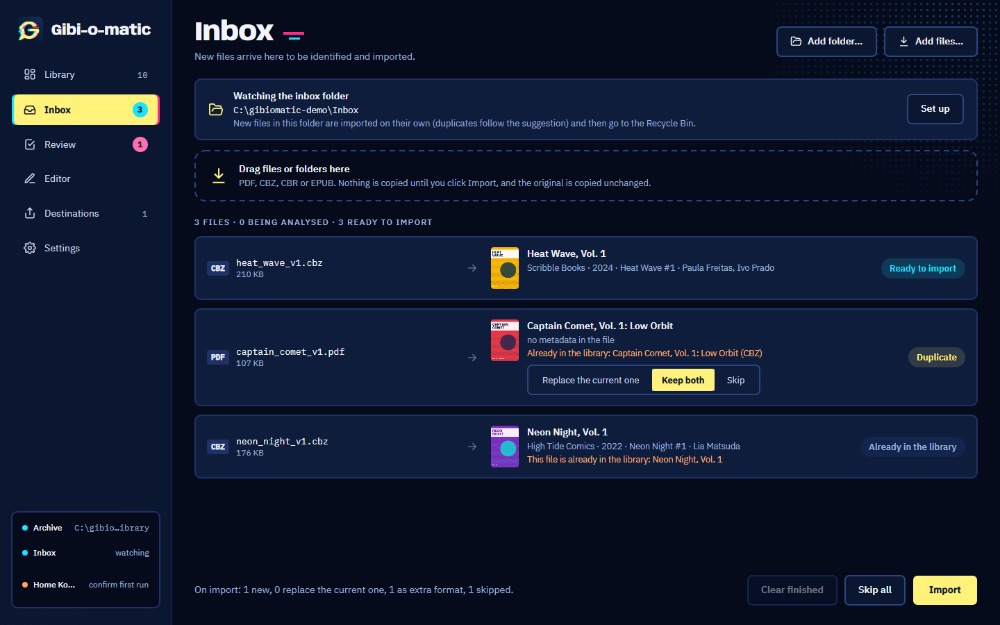
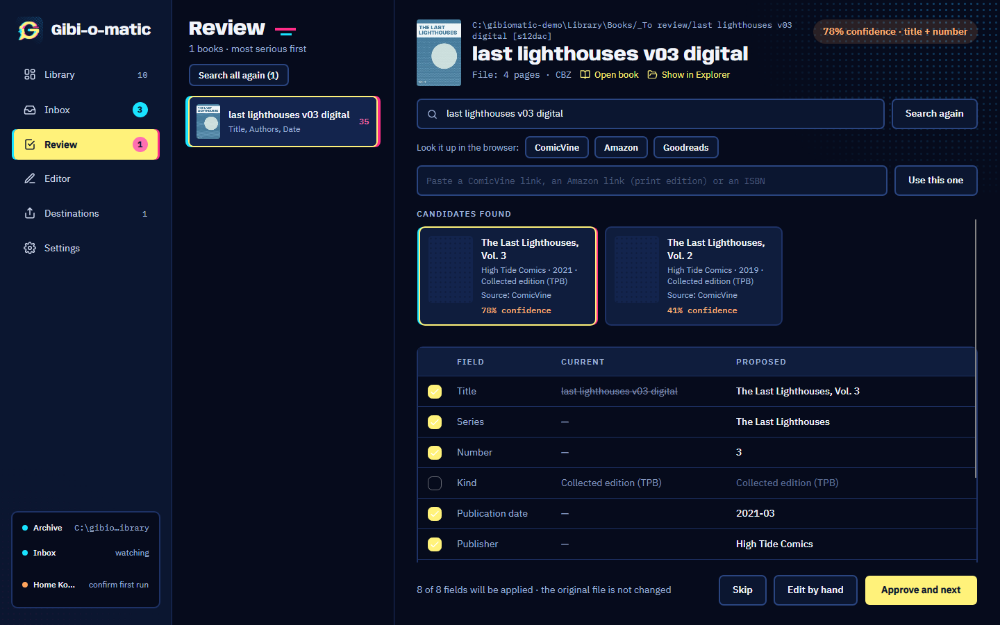
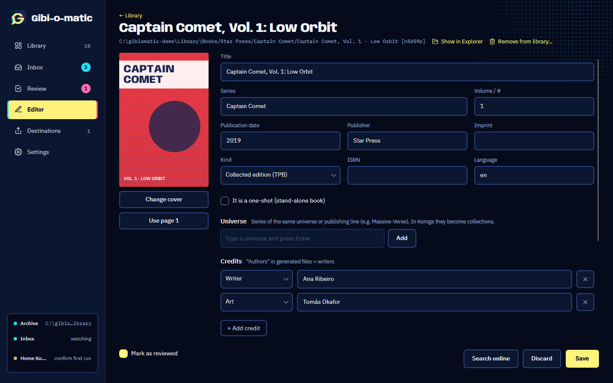
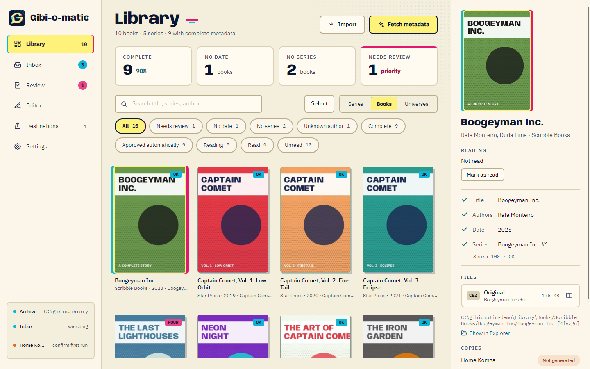

<p align="center">
  
</p>

<h1 align="center">Gibi-o-matic</h1>

<p align="center">
  <strong>Your digital comics, organized: pristine originals, correct metadata, reading copies for Komga and Kindle.</strong>
</p>

<p align="center">
  <a href="https://github.com/homemdelata/gibi-o-matic/actions/workflows/ci.yml"></a>
  <a href="https://github.com/homemdelata/gibi-o-matic/releases/latest"></a>
  
  <a href="LICENSE"></a>
</p>

<p align="center">
  English · <a href="README.pt-BR.md">Português (Brasil)</a>
</p>



Gibi-o-matic is a desktop app (Windows and Linux) for people who **buy DRM-free digital comics** (Humble Bundle
and similar stores) and want to keep them well organized and read them comfortably. *Gibi* is Brazilian
Portuguese for "comic book".

## Why it exists

Buy a few comics bundles and you end up with hundreds of files named `house_of_slaughter_v01_digital.pdf`, in a
mix of PDF, CBZ and EPUB, with metadata that is missing, wrong or glued together. Then each place you read wants
something different:

- a server like [Komga](https://komga.org) wants CBZ files with a `ComicInfo.xml` inside and a sensible folder layout;
- a Kindle wants each book converted by [Kindle Comic Converter](https://github.com/ciromattia/kcc) and copied over USB;
- and your backup should keep the files **exactly as you bought them**.

General ebook managers such as Calibre are built for prose: they rewrite your files in place and know little
about series, volumes, collected editions or creator credits. Gibi-o-matic does only comics, and treats the
archive of originals as sacred: metadata lives next to each original in a `metadata.json`, and every reading copy
is generated from it.

```
INBOX ──import──► ARCHIVE (original + metadata.json) ──generate──► DESTINATIONS
  │                     ▲          │                                ├─ Komga  (CBZ + ComicInfo.xml)
  └── metadata lookup ──┘          └── Review / Editor              └─ Kindle (via KCC, over USB)
```

## Features

- **An archive of untouched originals.** Each book gets a folder with the original exactly as downloaded (PDF,
  CBZ, CBR or EPUB), its cover and a `metadata.json`. Originals are never modified. The same book in several
  formats becomes one book, with your preferred format as the main original.
- **Automatic inbox.** Point it at your downloads folder and new files are imported on their own, then sent to
  the Recycle Bin (or moved to an `_imported` folder inside the inbox, if you prefer). Books wait in `_To review`
  until their metadata is approved.
  The app can live in the system tray and start with your computer.
- **Metadata from ComicVine and Open Library.** Confident matches are approved automatically; the rest wait in
  the **Review** screen with a field-by-field comparison. The **Editor** handles everything else, including batch
  edits, credits by role and *universes* (series from the same line, which become collections in Komga). A
  quality score points out what each book is missing.
- **Destinations.** **Komga** gets CBZ files with `ComicInfo.xml`, organized by series. **Kindle** gets copies
  converted ahead of time, sent over USB when you plug the device in. Editing a book updates its copies.
- **A built-in reader** for CBZ, CBR, PDF and EPUB, with two-page spreads, right-to-left reading and reading
  progress, so you can check which edition a file really is.
- English and Brazilian Portuguese interface, dark and light themes, and update notifications (nothing is
  installed until you say so).

| Inbox | Review |
|---|---|
|  |  |
| **Editor** | **Light theme** |
|  |  |

The screenshots use a made-up library (titles, creators and covers are fictional), generated by
[`tools/Screenshots`](tools/Screenshots).

### What it is not

- Not a store and not a downloader: you bring the files you bought.
- **It does not remove DRM**, and never will. It is meant for DRM-free purchases.
- Not a full comic reader or a server: Komga, your tablet and your Kindle do that well. The built-in reader is
  for checking books, not for replacing them.

## Installation

Download the latest version from [**Releases**](https://github.com/homemdelata/gibi-o-matic/releases/latest):

- **Windows 10 or 11:** `Gibi-o-matic-win-Setup.exe`. It installs for your user only, without administrator
  rights, and adds shortcuts to the desktop and the Start menu. The installer is not signed yet, so the first
  time Windows may warn about an "unknown publisher": click *More info* → *Run anyway*.
- **Linux (x64):** `Gibi-o-matic.AppImage`. Make it executable (`chmod +x Gibi-o-matic.AppImage`) and run it.

The app ships with its own .NET runtime; there is nothing else to install. It checks GitHub for new versions and
tells you when one is available; nothing is installed until you say so.

macOS is not supported for now.

## Getting started

1. **Create a library** in an empty folder (a synced folder such as Google Drive works fine). That is where the
   originals and metadata live. The index and caches stay outside it, on your machine.
2. **Add a ComicVine API key** (recommended): create a free account at
   [comicvine.gamespot.com/api](https://comicvine.gamespot.com/api/) and paste the key in *Settings → Metadata*.
   On Windows it is stored encrypted with your user account (DPAPI) and never written to a text file. On Linux,
   where that is not available yet, set the `GIBIOMATIC_COMICVINE_KEY` environment variable instead.
3. **Import** by dragging files onto the *Inbox*, or pick an Inbox folder in *Settings → Folders* so downloads
   come in by themselves.
4. **Review** whatever the identification did not approve on its own.
5. **Add a destination** under *Destinations*:
   - **Komga:** the folder of a Komga library. The server address and API key are optional; with them the app
     asks Komga to rescan after each change.
   - **Kindle:** the app downloads Kindle Comic Converter when you ask (it is not bundled). To build Kindle
     files, KCC needs KindleGen, which comes with Amazon's Kindle Previewer: install that first. Sending over USB
     is Windows-only for now.

## Where things live

| What | Where |
|---|---|
| Originals, covers and `metadata.json` | the library folder you chose |
| Settings | `%APPDATA%\GibiOMatic` (Linux: `~/.config/gibiomatic`) |
| Index, thumbnails, cache and logs | `%LOCALAPPDATA%\GibiOMatic` (Linux: `~/.local/share/gibiomatic`) |
| Installed program | `%LOCALAPPDATA%\Gibi-o-matic` |

Uninstalling removes only the program: your library, settings and index stay where they are. The library is
plain folders and JSON, readable without the app, and the index can always be rebuilt from it.

### Privacy

No telemetry, no accounts. The app only goes online for metadata lookups (ComicVine, Open Library and, if you
turn it on, Google Books), to download Kindle Comic Converter (from GitHub, when you ask) and to check for updates
(GitHub). The contents of your files never leave your machine.

## Building from source

You need the [.NET 10 SDK](https://dotnet.microsoft.com/download) (the exact version is pinned in
[`global.json`](global.json)).

```
git clone https://github.com/homemdelata/gibi-o-matic.git
cd gibi-o-matic
dotnet build GibiOMatic.sln
dotnet test --solution GibiOMatic.sln
dotnet run --project src/GibiOMatic.App
```

To build the installers locally: `powershell -ExecutionPolicy Bypass -File tools\publish.ps1 [-Runtime linux-x64]`.
See [`CONTRIBUTING.md`](CONTRIBUTING.md) for the project layout, the rules and how to send changes.

## Contributing

Bug reports, ideas and pull requests are welcome. This is a personal project maintained in spare time, so
please read [`CONTRIBUTING.md`](CONTRIBUTING.md) first: bug fixes can go straight to a pull request, while new
features and screen changes should start with an issue so we can agree on them before you write code.

Please follow the [Code of Conduct](CODE_OF_CONDUCT.md), and report security issues privately as described in
[`SECURITY.md`](SECURITY.md).

### About the documentation and AI assistance

The design documents in [`docs/`](docs/) (specification, roadmap, decisions, research) are written in Brazilian
Portuguese, the maintainer's language. Code, comments and the contributor-facing files are in English.

Gibi-o-matic is developed with the help of [Claude Code](https://claude.com/claude-code). The instructions it
follows are in [`CLAUDE.md`](CLAUDE.md), which doubles as a compact guide to the project's rules.

## Acknowledgements

Gibi-o-matic stands on the shoulders of [Avalonia](https://avaloniaui.net), [PDFium](https://pdfium.googlesource.com/pdfium/),
[SharpCompress](https://github.com/adamhathcock/sharpcompress), [SkiaSharp](https://github.com/mono/SkiaSharp),
[Velopack](https://velopack.io) and others listed in [`docs/THIRD-PARTY.md`](docs/THIRD-PARTY.md); of
[Kindle Comic Converter](https://github.com/ciromattia/kcc) and [Komga](https://komga.org); and of the
[ComicVine](https://comicvine.gamespot.com) and [Open Library](https://openlibrary.org) communities that
catalogue comics. The fonts are [Anybody](https://github.com/Etcetera-Type-Co/Anybody) and
[IBM Plex](https://github.com/IBM/plex), under the SIL Open Font License.

Gibi-o-matic is an independent project, not affiliated with or endorsed by Humble Bundle, Amazon, Komga,
ComicVine, Open Library or any publisher. Product names are trademarks of their owners.

## License

[MIT](LICENSE). Third-party components and their licenses are listed in [`docs/THIRD-PARTY.md`](docs/THIRD-PARTY.md).
