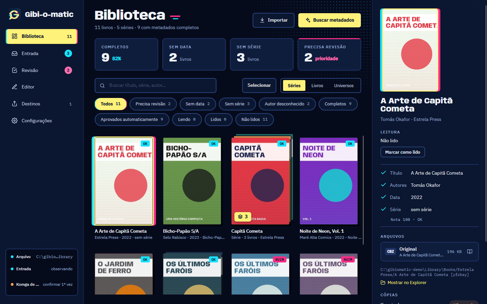
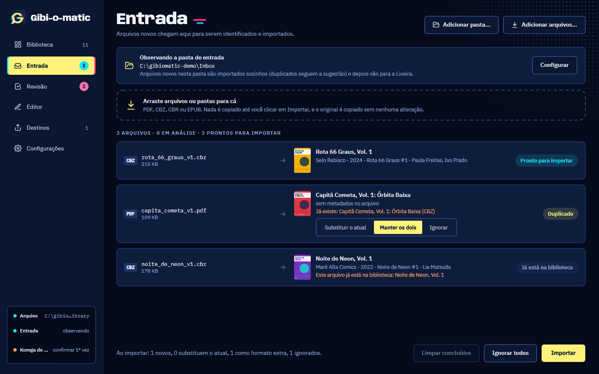
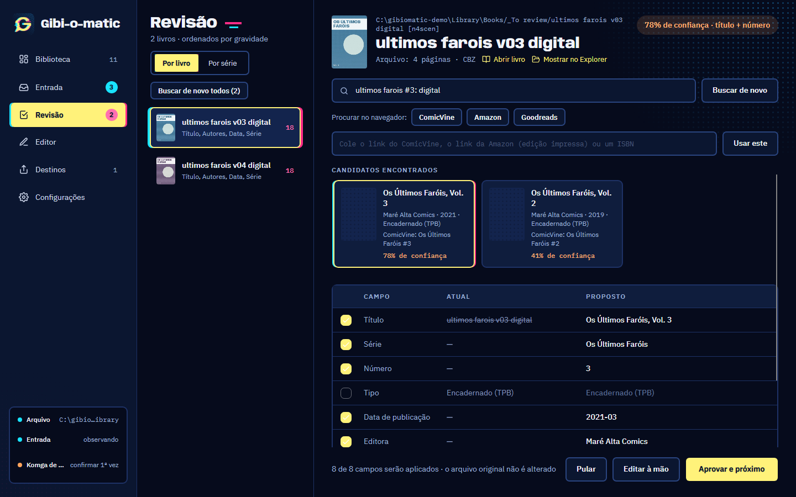
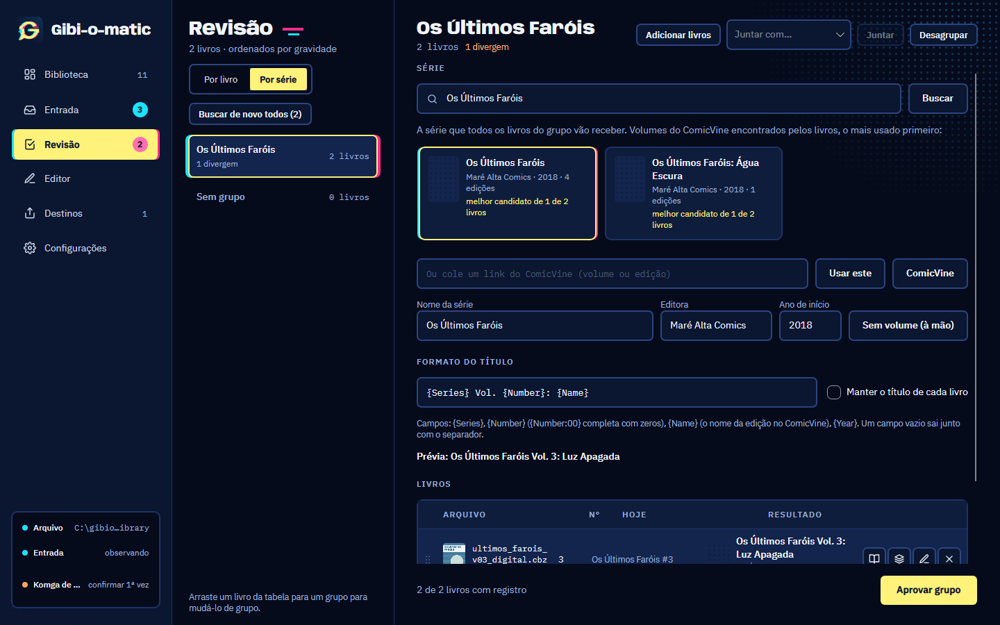
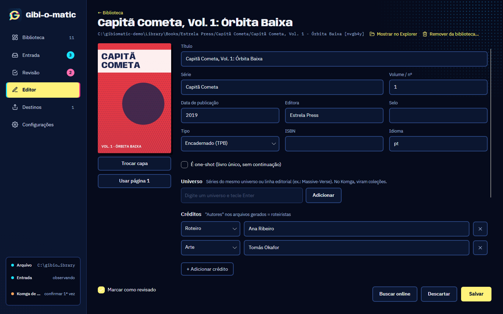
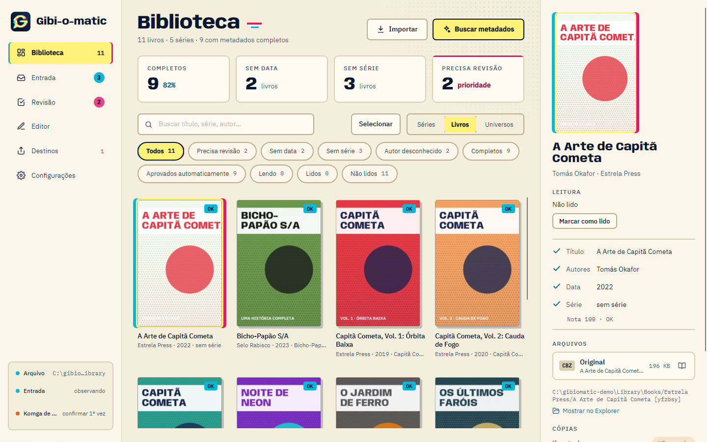

<p align="center">
  
</p>

<h1 align="center">Gibi-o-matic</h1>

<p align="center">
  <strong>Seus quadrinhos digitais organizados: originais intocados, metadados certos e cópias de leitura para o Komga e o Kindle.</strong>
</p>

<p align="center">
  <a href="https://github.com/homemdelata/gibi-o-matic/actions/workflows/ci.yml"></a>
  <a href="https://github.com/homemdelata/gibi-o-matic/releases/latest"></a>
  
  <a href="LICENSE"></a>
</p>

<p align="center">
  <a href="README.md">English</a> · Português (Brasil)
</p>



O Gibi-o-matic é um app desktop (Windows e Linux) para quem **compra quadrinhos digitais sem DRM** (Humble
Bundle e lojas parecidas) e quer guardá-los bem organizados e lê-los com conforto.

## Por que ele existe

Depois de alguns bundles, sobram centenas de arquivos chamados `house_of_slaughter_v01_digital.pdf`, misturando
PDF, CBZ e EPUB, com metadados faltando, errados ou grudados. E cada lugar onde você lê quer uma coisa diferente:

- um servidor como o [Komga](https://komga.org) quer CBZ com `ComicInfo.xml` dentro e pastas bem organizadas;
- o Kindle quer cada livro convertido pelo [Kindle Comic Converter](https://github.com/ciromattia/kcc) e copiado por USB;
- e o backup deve guardar os arquivos **exatamente como foram comprados**.

Gerenciadores de ebooks como o Calibre são feitos para livros de texto: reescrevem os arquivos e entendem pouco
de séries, volumes, encadernados e créditos por função. O Gibi-o-matic só cuida de quadrinhos e trata o arquivo
de originais como intocável: os metadados ficam ao lado de cada original, num `metadata.json`, e todas as cópias
de leitura são geradas a partir dele.

```
ENTRADA ──importar──► ARQUIVO (original + metadata.json) ──gerar──► DESTINOS
   │                        ▲         │                              ├─ Komga  (CBZ + ComicInfo.xml)
   └─ busca de metadados ───┘         └─ Revisão / Editor            └─ Kindle (pelo KCC, por USB)
```

## O que ele faz

- **Arquivo dos originais.** Cada livro ganha uma pasta com o original como foi baixado (PDF, CBZ, CBR ou
  EPUB), a capa e um `metadata.json`. O original nunca é alterado; o mesmo livro em vários formatos vira um
  livro só, com o formato preferido como principal.
- **Entrada automática.** Aponte a pasta de downloads e cada arquivo novo entra sozinho na biblioteca. Depois
  ele vai para a Lixeira (ou para `_imported`, dentro da pasta de Entrada, se preferir). Os livros esperam em
  `_To review` até os metadados serem aprovados. O app pode ficar na bandeja do sistema e iniciar com ele.
- **Metadados do ComicVine e da Open Library.** As identificações seguras são aprovadas sozinhas, e as outras
  esperam na **Revisão**, com a comparação campo a campo, um livro por vez ou **por série** (escolha a série do
  ComicVine e o formato do título uma vez, aprove todos os livros dela juntos e desfaça tudo de uma vez). O **Editor** cuida do resto, inclusive em lote, com
  créditos por função e *universos* (séries da mesma linha, que viram coleções no Komga). Uma nota de qualidade
  aponta o que falta em cada livro.
- **Destinos.** O **Komga** recebe CBZ com `ComicInfo.xml`, organizados por série. O **Kindle** recebe as
  cópias convertidas antes, enviadas por USB quando você conecta o aparelho. Editar um livro atualiza as cópias.
- **Leitor** próprio para CBZ, CBR, PDF e EPUB, com página dupla, leitura da direita para a esquerda e
  progresso de leitura, para conferir qual edição é cada arquivo.
- Interface em português e em inglês, tema escuro e tema claro, e aviso de novas versões (nada é instalado sem
  você pedir).

| Entrada | Revisão |
|---|---|
|  |  |
| **Revisão por série** | **Editor** |
|  |  |
| **Tema claro** | |
|  | |

As capturas usam uma biblioteca inventada (títulos, autores e capas fictícios), gerada por
[`tools/Screenshots`](tools/Screenshots).

### O que ele não é

- Não é loja nem baixa compras: você traz os arquivos que comprou.
- **Não remove DRM**, e nunca vai remover. Ele é feito para compras sem DRM.
- Não é um leitor completo nem um servidor: o Komga, o tablet e o Kindle fazem isso bem. O leitor embutido serve
  para conferir os livros, não para substituí-los.

## Instalação

Baixe a última versão em [**Releases**](https://github.com/homemdelata/gibi-o-matic/releases/latest):

- **Windows 10 ou 11:** `Gibi-o-matic-win.msi`. Ele instala só para o seu usuário, sem pedir administrador, e
  cria atalhos na área de trabalho e no menu Iniciar. O instalador ainda não é assinado (veja a
  [política de assinatura](docs/CODE-SIGNING.md), em inglês), então o Windows pode avisar "editor desconhecido":
  clique em *Mais informações* → *Executar assim mesmo*.
- **Linux (x64):** `Gibi-o-matic.AppImage`. Dê permissão de execução (`chmod +x Gibi-o-matic.AppImage`) e abra.

O app já traz o .NET; não é preciso instalar mais nada. Ele procura versões novas no GitHub e avisa quando há
uma (dá para desligar nas Configurações); nada é instalado sem você pedir.

Por enquanto, não há versão para macOS.

## Primeiros passos

1. **Crie a biblioteca** numa pasta vazia (pode ser numa pasta sincronizada, como o Google Drive). É lá que ficam
   os originais e os metadados. O índice e o cache ficam fora dela, na sua máquina.
2. **Chave do ComicVine** (recomendada): crie uma conta gratuita em
   [comicvine.gamespot.com/api](https://comicvine.gamespot.com/api/) e cole a chave em *Configurações → Metadados*.
   No Windows ela fica guardada criptografada com a sua conta de usuário (DPAPI) e nunca vai para arquivos de
   texto. No Linux, onde isso ainda não existe, use a variável de ambiente `GIBIOMATIC_COMICVINE_KEY`.
3. **Importe** arrastando arquivos para a *Entrada*, ou escolha uma pasta de Entrada em
   *Configurações → Pastas* para os downloads entrarem sozinhos.
4. **Revise** o que a identificação não aprovou sozinha.
5. **Adicione um destino** em *Destinos*:
   - **Komga:** a pasta de uma biblioteca do Komga. O endereço e a chave do servidor são opcionais; com eles, o
     app pede ao Komga uma nova leitura da pasta depois de cada mudança.
   - **Kindle:** o app baixa o Kindle Comic Converter quando você pede (ele não vem junto). Para gerar os
     arquivos, o KCC usa o KindleGen, que vem com o Kindle Previewer, da Amazon: instale-o antes. Por enquanto,
     o envio por USB só funciona no Windows.

## Onde ficam as coisas

| O quê | Onde |
|---|---|
| Originais, capas e `metadata.json` | na pasta da biblioteca que você escolheu |
| Configurações | `%APPDATA%\GibiOMatic` (Linux: `~/.config/gibiomatic`) |
| Índice, miniaturas, cache e logs | `%LOCALAPPDATA%\GibiOMatic` (Linux: `~/.local/share/gibiomatic`) |
| Programa instalado | `%LOCALAPPDATA%\Gibi-o-matic` |

Desinstalar remove só o programa: a biblioteca, as configurações e o índice continuam onde estão. A biblioteca é
feita de pastas e JSON comuns, que dá para ler sem o app, e o índice sempre pode ser reconstruído a partir dela.

### Privacidade

Sem telemetria e sem contas. O app só usa a internet para as buscas de metadados (ComicVine, Open Library e, se
você ligar, Google Books), para baixar o Kindle Comic Converter (do GitHub, quando você pede) e para procurar
atualizações (GitHub; *Configurações → Geral → Procurar atualizações automaticamente* desliga). O conteúdo dos
seus arquivos não sai da sua máquina. Os detalhes, com as políticas de cada serviço, estão na
[política de assinatura](docs/CODE-SIGNING.md#privacy-policy), em inglês.

### Política de assinatura de código

Assinatura de código gratuita fornecida por [SignPath.io](https://about.signpath.io), certificado da
[SignPath Foundation](https://signpath.org) (inscrição em análise). O que é assinado, quem aprova e a política de
privacidade estão em [`docs/CODE-SIGNING.md`](docs/CODE-SIGNING.md), em inglês.

## Compilando

É preciso o [.NET 10 SDK](https://dotnet.microsoft.com/download) (a versão exata fica em [`global.json`](global.json)).

```
git clone https://github.com/homemdelata/gibi-o-matic.git
cd gibi-o-matic
dotnet build GibiOMatic.sln
dotnet test --solution GibiOMatic.sln
dotnet run --project src/GibiOMatic.App
```

Para gerar os instaladores na sua máquina: `powershell -ExecutionPolicy Bypass -File tools\publish.ps1 [-Runtime linux-x64]`.
Veja o [`CONTRIBUTING.md`](CONTRIBUTING.md) (em inglês, como toda a documentação do projeto) para a estrutura do projeto, as regras e como mandar mudanças.

## Contribuindo

Relatos de bugs, ideias e pull requests são bem-vindos, em inglês ou em português. Este é um projeto pessoal,
mantido no tempo livre, então leia o [`CONTRIBUTING.md`](CONTRIBUTING.md) antes: correções de bugs podem ir
direto para um pull request, mas funcionalidades novas e mudanças de tela começam por uma issue, para
combinarmos antes de você escrever o código.

Siga o [Código de Conduta](CODE_OF_CONDUCT.md) e informe problemas de segurança de forma privada, como explica o
[`SECURITY.md`](SECURITY.md).

### Documentação e uso de IA

Os documentos de projeto ficam em [`docs/`](docs/), em inglês: a especificação, o roadmap, o design, a pesquisa e o
registro das decisões por trás do app.

O Gibi-o-matic é desenvolvido com a ajuda do [Claude Code](https://claude.com/claude-code). As instruções que ele
segue estão no [`CLAUDE.md`](CLAUDE.md), que também serve como um resumo das regras do projeto.

## Agradecimentos

O Gibi-o-matic se apoia no [Avalonia](https://avaloniaui.net), no [PDFium](https://pdfium.googlesource.com/pdfium/),
no [SharpCompress](https://github.com/adamhathcock/sharpcompress), no [SkiaSharp](https://github.com/mono/SkiaSharp),
no [Velopack](https://velopack.io) e nos outros componentes listados em [`docs/THIRD-PARTY.md`](docs/THIRD-PARTY.md);
no [Kindle Comic Converter](https://github.com/ciromattia/kcc) e no [Komga](https://komga.org); e nas comunidades do
[ComicVine](https://comicvine.gamespot.com) e da [Open Library](https://openlibrary.org), que catalogam os
quadrinhos. As fontes são a [Anybody](https://github.com/Etcetera-Type-Co/Anybody) e a
[IBM Plex](https://github.com/IBM/plex), sob a SIL Open Font License.

O Gibi-o-matic é um projeto independente, sem vínculo com Humble Bundle, Amazon, Komga, ComicVine, Open Library
ou qualquer editora, e sem o endosso deles. Os nomes de produtos são marcas dos seus donos.

## Licença

[MIT](LICENSE). Os componentes de terceiros e as licenças deles estão em [`docs/THIRD-PARTY.md`](docs/THIRD-PARTY.md).
